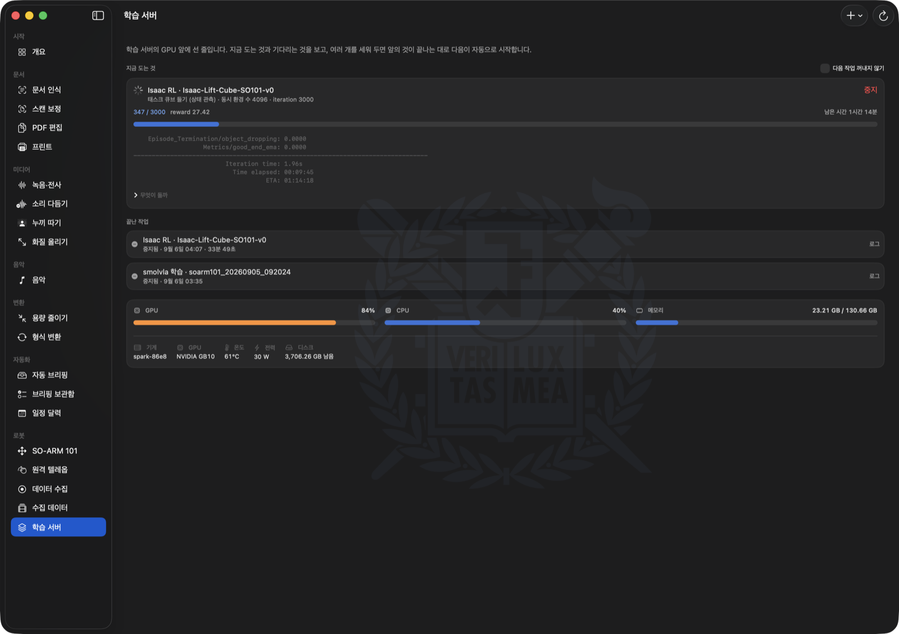

# sparkq

A small job queue built to run GPU workloads sequentially on a robotics training server.
It supports DGX Spark and Apple Silicon Macs using the Python standard library and tmux.

- **Type:** Personal development tool
- **Main work:** GPU job queue · CLI and HTTP API · Training logs and checkpoint management
- **Technologies:** Python standard library · tmux · systemd / launchd



<sub>Viewing the queue in a Mac app I built, with job progress, pending jobs, and GPU status in one place.</sub>

## Overview

I built sparkq to reduce slowdowns caused by overlapping jobs on a training server with unified memory.
Regular training runs sequentially in a single slot. Viewers and policy inference run in a separate lane with time limits.

## Implementation

- **Execution order:** Manages pending jobs and starts the next training run when the GPU is available.
- **Experiment monitoring:** Exposes logs, training curves, and checkpoints through the CLI and HTTP API.
- **Job types:** Registers training, viewer, and policy execution jobs using constrained inputs defined in JSON specifications.
- **Persistent state:** Stores execution records in files and uses tmux sessions so jobs remain manageable after the queue daemon restarts.

## Getting Started

On Linux, the installer registers a user systemd service.

```bash
bash install.sh
sparkq kinds
sparkq ls
```

On Mac, install tmux and register the LaunchAgent.

```bash
brew install tmux
bash install-macos.sh
SPARKQ_PORT=8093 sparkq ls
```

Check the installed job types and datasets before submitting a job.

```bash
sparkq add lerobot-train dataset=<name> policy=act
sparkq log <id>
```

See the [usage guide](docs/usage.md) for reordering, cancellation, pausing, and the HTTP API.

## Documentation

The linked usage, design, and agent instructions are in Korean.

| Document | Contents |
| --- | --- |
| [Installation and usage](docs/usage.md) | OS-specific installation/removal, CLI, HTTP API, and custom job types |
| [Design notes](docs/design-notes.md) | Single slot, file-based state, and OS differences |
| [Inference and training preemption](docs/2026-09-07-preempt.md) | Side-lane jobs and training resumption |
| [Agent rules](AGENTS.md) · [Server home instructions](AGENTS-home.md) | Rules requiring GPU workloads to run through the queue |

## Scope and Limitations

- Designed for a personal environment with one GPU. It is not a scheduler for distributing work across multiple nodes or GPUs.
- Linux checks GPU occupancy with `nvidia-smi`. Mac does not support the same GPU process query.
- The API has no authentication and binds only to a local address. Use an SSH tunnel for remote access.
- Linux enables linger. Mac requires a logged-in session, and closing the lid may interrupt jobs.
- Default job specifications assume the current training environment. Adjust data paths and virtual environments for other machines.

## Related Projects

I use sparkq when transferring data collected with [SO-ARM101 Console](https://github.com/sesepark/soarm101-console) to the training server for experiments.
The console controls the arms and cameras; sparkq handles GPU job execution and records.
