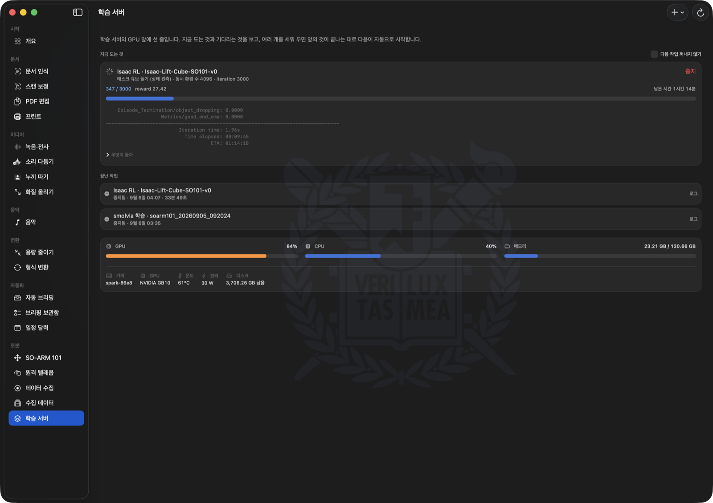

# sparkq

로봇 학습 서버에서 여러 GPU 작업을 순서대로 실행하려고 만든 작은 작업 큐.
DGX Spark와 Apple Silicon Mac을 지원하며, Python 표준 라이브러리와 tmux로 동작한다.

[주요 기능](#주요-기능) · [시작하기](#시작하기) · [문서](#문서)



<sub>직접 만든 맥 앱에서 큐를 조회하는 예. 진행 상황과 대기 작업, GPU 상태를 함께 확인한다.</sub>

## 주요 기능

- **순서대로 실행** — 대기열을 관리하고, GPU가 비었을 때 다음 학습을 시작한다.
- **진행 상황 확인** — CLI·HTTP API로 로그, 학습 곡선, 체크포인트를 확인한다.
- **작업 종류 추가** — JSON 명세에 정해진 입력으로 학습·뷰어·정책 실행 작업을 등록한다.

통합메모리를 쓰는 학습 서버에서 작업이 겹쳐 느려지는 문제를 줄이기 위해 만들었다.
대기열과 실행 기록은 파일로 보관하고, 실행은 tmux 세션에 남겨 큐 데몬이 재시작돼도 이어서 관리한다.
기본 학습은 한 슬롯에서 순차 실행하며, 뷰어·정책 추론은 시한이 있는 별도 레인으로 관리한다.

## 시작하기

리눅스에서는 설치 스크립트가 사용자 systemd 서비스를 등록한다.

```bash
bash install.sh
sparkq kinds
sparkq ls
```

맥에서는 tmux를 준비하고 LaunchAgent를 등록한다.

```bash
brew install tmux
bash install-macos.sh
SPARKQ_PORT=8093 sparkq ls
```

설치된 작업 종류와 데이터셋을 확인한 뒤 등록한다.

```bash
sparkq add lerobot-train dataset=<이름> policy=act
sparkq log <id>
```

대기 순서 변경·취소·일시 정지와 HTTP API는 [사용법](docs/usage.md)에 정리했다.

## 문서

| 문서 | 내용 |
| --- | --- |
| [설치와 사용법](docs/usage.md) | 운영체제별 설치·해제, CLI, HTTP API, 작업 종류 확장 |
| [설계 기록](docs/design-notes.md) | 단일 슬롯, 파일 기반 상태, 운영체제별 차이 |
| [추론과 학습 일시 정지](docs/2026-09-07-preempt.md) | 별도 레인의 작업과 학습 재개 |
| [에이전트 규칙](AGENTS.md) · [서버 홈 안내](AGENTS-home.md) | GPU 작업을 큐로 실행하는 규칙 |

## 사용 범위와 한계

- GPU 한 대를 사용하는 개인 환경용이다. 여러 노드·GPU를 나눠 쓰는 스케줄러는 아니다.
- Linux에서는 `nvidia-smi`로 GPU 점유를 확인한다. Mac은 같은 GPU 프로세스 조회를 지원하지 않는다.
- API에는 인증이 없으며 로컬 주소에만 열린다. 원격 접속은 SSH 터널을 사용한다.
- Linux는 linger를 설정한다. Mac은 로그인 상태가 필요하며, 덮개를 닫으면 작업이 중단될 수 있다.
- 기본 작업 명세는 현재 학습 환경을 가정한다. 데이터 경로·가상환경은 다른 기계에 맞게 수정해야 한다.

**구성:** Python 표준 라이브러리 · tmux · systemd / launchd

## 관련 프로젝트

[SO-ARM101 Console](https://github.com/sesepark/soarm101-console)에서 수집한 데이터를 학습 서버로 옮겨 실험할 때 사용한다.
팔·카메라의 제어는 콘솔이 맡고, GPU 작업의 실행과 기록은 sparkq가 맡는다.
