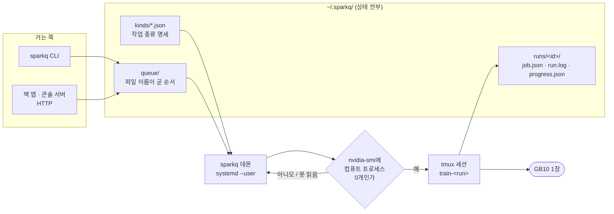

# sparkq 설계 기록

[프로젝트 소개](../README.md)

## 왜 만들었나

이 기계의 희소 자원은 GB10 한 장이다. 그래서 슬롯은 하나이고, 큐는 한 번에 하나만 돌림.
통합메모리라 두 학습이 겹치면 OOM으로 깨지는 대신 **둘 다 스왑으로 느려지는** 방식으로
망가지는데, 그쪽이 훨씬 알아채기 어려움. 겹치지 않게 하는 것이 이 프로그램의 전부임.



## 설계에서 신경 쓴 부분

- **슬롯 하나, 비선점.** 시작한 작업은 끝나거나 사람이 세울 때까지 둠. 학습은 몇 시간짜리라
  중간에 뺏으면 처음부터 다시 해야 하기 때문임. 아직 시작하지 않은 줄은 얼마든지 다시 세울 수
  있음(`top`).
- **상태는 디스크에.** `~/.sparkq/queue/`의 파일 이름이 곧 순서(우선순위 → 들어온 시각)이고,
  실행 중인 것은 `~/.sparkq/runs/<id>/`에 `job.json`·`run.log`·`progress.json`으로 남음.
  데몬이 `systemctl --user restart` 돼도 도는 학습은 tmux 안에서 그대로 돌고, 올라온 데몬이
  세션 이름으로 다시 찾아 붙음.
- **GPU가 실제로 비었을 때만 다음을 꺼냄.** 앞 작업이 끝났는지가 아니라 `nvidia-smi`에 컴퓨트
  프로세스가 하나도 없는지를 봄. 사람이 터미널에서 직접 띄운 학습 위에 올라타지 않기 위해서임.
  nvidia-smi를 못 읽으면(빈 목록과 다르다) 시작하지 않고 기다림.
- **작업 종류는 코드가 아니라 파일로 늘림.** `kinds/*.json` 하나가 종류 하나라, 새 실험을 걸 수
  있게 하는 데 코드를 고칠 필요가 없음. 대신 그 JSON이 셸 명령을 만들므로 값은 목록(`enum`)과
  범위(`int`)와 이름(`name`)으로만 받음 — 자유 문자열 형식은 일부러 없다. 그것이 들어가는 순간
  이 큐는 원격 셸이 되기 때문임.
- **무엇이 돌 것인지 걸 때 확정함.** `${이름}`은 `string.Template`으로 치환되고, 만들어 낸 셸
  명령은 **걸 때** 확정되어 작업 파일에 그대로 적힘. 사람이 보지 않는 동안 도는 것들이라,
  무엇이 돌 것인지 미리 읽을 수 있어야 하기 때문임.

## 구성

```
sparkq.py            큐 · 데몬 · CLI · HTTP 서버 전부 (표준 라이브러리만)
probe/               기계에 묶인 것만 (아래 표)
  linux.py             nvidia-smi · /proc · timeout
  darwin.py            ioreg · vm_stat · host_statistics · pmset · caffeinate
sparkq.service       systemd --user 유닛 (리눅스)
sparkq.macos.plist   LaunchAgent (맥)
install.sh           linger 켜기와 서비스 등록 (리눅스)
install-macos.sh     LaunchAgent 등록 (맥)
kinds/               리눅스에서 걸 수 있는 작업 종류 (JSON 하나가 종류 하나)
  lerobot-train.json   LeRobot 정책 학습 (act | smolvla)
  isaac-rl.json        Isaac Lab 강화학습
  isaac-play.json      Isaac 뷰어 (곁다리 레인)
kinds-macos/         맥에서 걸 수 있는 작업 종류
  lerobot-train.json   LeRobot 정책 학습 — 밤 하나에 들어가는 크기로 프리셋
  lerobot-resume.json  지난 밤에 멈춘 학습을 이어 붙이기
```

### 기계에 묶인 다섯 가지

| | 리눅스 (`probe/linux.py`) | 맥 (`probe/darwin.py`) |
|---|---|---|
| GPU를 쥔 프로세스 | `nvidia-smi --query-compute-apps` | **볼 수 없음** — 문지기에서 이 검사가 빠짐 |
| 기계 상태 | nvidia-smi · `/proc/stat` · `/proc/meminfo` | `ioreg` · `host_statistics` · `vm_stat` · `pmset` |
| 프로세스 트리 | `/proc/<pid>/task/<pid>/children` | `ps -A -o pid=,ppid=`를 한 번 읽어 뒤집음 |
| 잡을 감싸는 것 | 없음 | `caffeinate -i -m -s` — 잡이 도는 동안만 안 잠듦 |
| 곁다리 시한 | `timeout` | `gtimeout`(coreutils). 없으면 곁다리를 **띄우지 않음** |

`gpu_processes`가 거짓인 기계는 `/api/queue`에서 `gpu_apps`를 **아예 싣지 않음.** 빈 목록으로
실으면 "확인했고 비어 있다"로 읽히는데 실제로는 확인할 방법이 없었던 것이고, 그 둘은 사람이
할 일이 정반대임. 무엇을 확인할 수 있는지는 `/api/status`의 `capabilities`가 말함.
